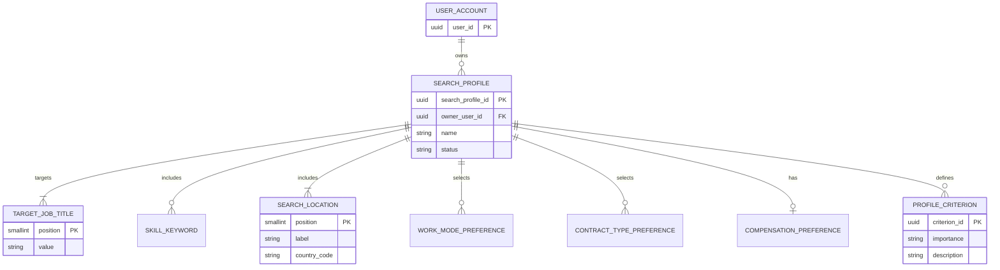

# MCD — identity and search profiles

## Scope and status

This conceptual data model covers only the minimal identity boundary and search-profile module defined today. It is not a schema for opportunities, recommendations, applications, documents, or automation.

**Validated for the current design:** one user owns zero or more independent search profiles; a profile owns its repeatable configuration values.

**Proposed, to confirm at backend bootstrap:** the canonical identity entity is named `UserAccount`, uses an internal UUID, and exposes only a stable owner reference to the search-profiles module.

## Entities and associations

| Entity | Meaning | Identifier |
| --- | --- | --- |
| `UserAccount` | Minimal identity representation; credentials and provider-specific claims are outside this model. | `userId` |
| `SearchProfile` | One user’s independent job-search configuration. | `searchProfileId` |
| `TargetJobTitle` | A target title owned by one profile. | `(searchProfileId, position)` |
| `SkillKeyword` | A skill or keyword owned by one profile. | `(searchProfileId, position)` |
| `SearchLocation` | A geographic location owned by one profile. `REMOTE` is a work mode, not a location. | `(searchProfileId, position)` |
| `WorkModePreference` | A selected work mode (`ONSITE`, `HYBRID`, `REMOTE`). | `(searchProfileId, workMode)` |
| `ContractTypePreference` | A selected contract type. | `(searchProfileId, contractType)` |
| `CompensationPreference` | Optional compensation range owned by one profile. | `searchProfileId` |
| `ProfileCriterion` | A required condition or preferred criterion owned by one profile. | `criterionId` |

## Cardinalities

- A `UserAccount` owns **0..N** `SearchProfile`; each `SearchProfile` belongs to **exactly 1** `UserAccount`.
- A `SearchProfile` owns **1..N** `TargetJobTitle` and **1..N** `SearchLocation`.
- A `SearchProfile` owns **0..N** skills, work-mode preferences, contract-type preferences, and criteria.
- A `SearchProfile` owns **0..1** compensation preference.
- No relationship to future matching, application, or document entities is modeled here. A future module that needs profile context owns its own reference/snapshot and retention policy.

## Mermaid diagram

## Business interpretation

`REQUIRED` and `PREFERRED` describe different user intent. A required criterion is a declared non-negotiable condition; a preferred criterion can improve relevance but must not automatically reject an opportunity. The MCD deliberately does not define a future match-result association or scoring algorithm.
